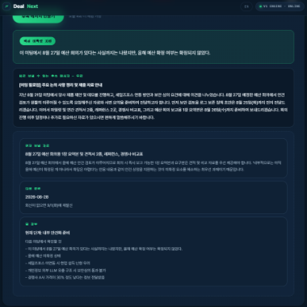
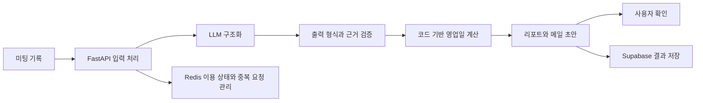

# DealNext AI

**미팅 기록을 후속 업무, 메일 초안과 다음 연락 날짜로 정리한 개인 프로젝트입니다.**

## 출발점

사업을 운영하며 투자와 PoC 협의가 여러 차례 이어질 때, 약속한 자료와 다음 연락 날짜를 다시 찾는 일이 많았습니다.
해외 바이어와는 언어 차이로 후속 대화를 이어가는 부담도 있었습니다.
미팅 기록에서 확인된 사실과 미해결 항목을 정리해 사용자가 다음 행동을 검토할 수 있도록 만들었습니다.

## 구현한 흐름

텍스트 등으로 입력한 기록을 구조화하고, 근거와 후속 행동을 리포트로 제공합니다.
날짜는 LLM이 직접 계산하게 두지 않고 한국 시간과 주말, 공휴일을 고려하는 코드로 계산합니다.
생성 결과의 JSON 형식, 근거 수준과 날짜 참조의 일관성을 검사합니다.
메일은 초안으로 제공하며 사용자가 확인한 뒤 직접 보내는 흐름입니다.

*가상 미팅을 사용한 기존 검토 화면입니다. 실제 고객의 대화나 성과 자료가 아닙니다.*

## 처리 흐름

리포트 렌더링에는 Jinja2를 사용했습니다.
일시적인 오류의 재시도와 최종 실패 시 사용량 복원도 처리 흐름에 포함했습니다.

## 내가 맡은 일

문제와 요구사항을 정하고 날짜 계산, 출력 검증 및 사용자 확인 기준을 설계했습니다.
AI 도구를 활용한 구현과 가상 입력을 이용한 결과 확인을 진행했습니다.
결제와 결과 열람 연결도 직접 확인했습니다.

## 확인한 결과와 범위

가상 미팅으로 무료 체험과 결제 후 결과 열람을 점검했습니다.
본인 카드의 2.99달러 결제와 전액 환불로 결제 연동을 확인했습니다.
이는 결제 기능 검증이며 고객 매출이나 시장 성과가 아닙니다.
미팅 상대의 의도나 미래 결과를 확정하는 서비스로 설명하지 않습니다.

## 기술

Python, FastAPI, LLM, Jinja2, Supabase, Redis, Paddle 연동을 사용했습니다.
자료는 2026년 6월부터 9월까지 수행한 구현과 검증을 정리한 것입니다.
현재 운영 상태나 공개 서비스 이용 가능성을 보장하는 소개는 아닙니다.

[소개 PDF](materials/DealNext_AI_소개자료.pdf) | [전체 소개](README.md)

소스 저장소는 비공개입니다. 이 문서는 외부 검토용 설명 자료입니다.
