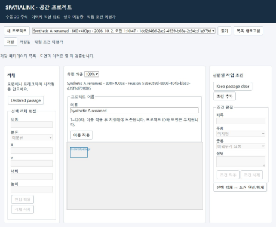
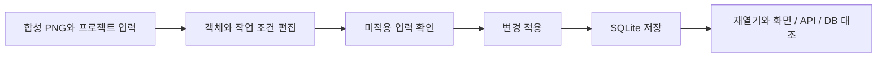

# SPATIALINK AI

**숙련자의 작업 방법과 판단 근거를 피지컬 AI 학습 자료로 남기기 위한 개인 프로젝트입니다.**

## 출발점

설계와 현장에서는 같은 도면을 보더라도 작업 순서와 판단이 달라집니다.
숙련자의 행동만 기록하면 어떤 조건에서 그 판단을 했는지 놓칠 수 있습니다.
작업 방법, 판단 이유와 교정 근거를 적용 조건과 함께 남기고 다른 업무에 재사용하는 방향으로 개발하고 있습니다.

## 현재 확인할 수 있는 기능

현재는 합성 PNG 위에서 객체와 작업 조건을 기록하는 로컬 2D 편집 흐름을 확인했습니다.
이미지와 객체를 등록하고 조건을 편집한 뒤 적용, 저장, 재열기를 구분합니다.
미적용 입력이 남으면 저장을 막아 화면 수정이 곧 저장 완료로 보이지 않도록 했습니다.
화면, API 응답과 SQLite 기록을 대조해 상태가 일치하는지 확인했습니다.

*기존 로컬 검증 화면입니다. 실제 현장 자동 인식 결과가 아닙니다.*

## 처리 흐름

별도의 main 기반에는 FastAPI 상태 및 메타데이터 검증 API와 근거 및 변경 이력 관리 기능이 있습니다.
main 기반과 별도 Draft의 로컬 편집기는 통합 배포한 서비스로 설명하지 않습니다.
메타데이터 검증 통과도 실제 치수나 자료 사용권 검증을 뜻하지 않습니다.

## 내가 맡은 일

문제 정의, 지원할 입력과 작업 범위, 검증 기준을 정했습니다.
AI 도구를 활용해 구현하고, 생성 코드의 설명과 실제 저장 결과를 나눠 확인했습니다.
변경 적용과 저장 상태를 구분하고 재열기 후 화면과 DB가 일치하는지 검증했습니다.

## 기술과 검증 범위

Python, FastAPI, SQLite를 사용한 로컬 개발입니다.
합성 입력을 이용한 편집 및 저장 검증과 기반 계약 검증을 수행했습니다.
피지컬 AI 학습, 실제 치수 복원, 3D 자동 재구성, 로봇 전이와 현장 효과는 검증 완료 범위가 아닙니다.

## 다음 검증 방향

사용 권한이 있는 실제 작업 자료와 독립된 평가 기준을 갖춘 한 가지 업무부터 검증하려고 합니다.
자료 준비와 수정에 드는 사람의 시간도 함께 비교할 계획입니다.

[소개 PDF](materials/SPATIALINK_AI_소개자료.pdf) | [전체 소개](README.md)

소스 저장소는 비공개입니다. 이 문서는 외부 검토용 설명 자료입니다.
